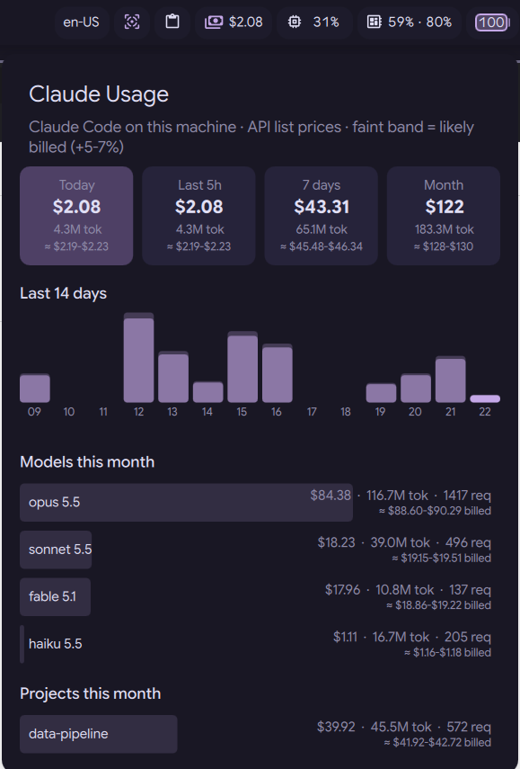

# Claude Daily Spend Estimate

Claude Code spend estimate for [DankMaterialShell](https://github.com/duxlabs-dev/dux-shell),
computed locally and never sent anywhere. A bar widget that reads Claude Code's own
session logs and prices the token usage at Anthropic API list prices.

<!--  -->

- **Bar pill:** spend for today, the last 5 hours, the last 7 days or this month (configurable)
- **Popout:** summary tiles, a 14-day bar chart, and this month's top models and projects
  by cost, tokens and requests

## Requirements

- DankMaterialShell
- `python3` (standard library only)

## Install

```sh
git clone https://github.com/inknos/DankClaudeDailyEstimateSpend.git ~/.config/dms/plugins/claudeDailyEstimateSpend
dms restart
```

Then enable **Claude Daily Spend Estimate** under Settings → Plugins and add it to the bar.

## Settings

| Setting          | Options                                   | Default |
| ---------------- | ----------------------------------------- | ------- |
| Bar shows        | Today, Last 5 hours, Last 7 days, This month | Today   |
| Refresh interval | 30 s, 1 min, 5 min                        | 1 min   |

By default the logs are read from `~/.claude/projects` and `~/.config/claude/projects`.
To use other directories, set `CLAUDE_USAGE_ROOTS` to a colon-separated list in the
environment DMS runs in.

## Privacy

Everything stays on your machine, and the plugin makes no network requests. `usage.py`
reads the `*.jsonl` session logs, keeps only the token counts, model, timestamp and
project directory name, and caches those per file in
`~/.cache/dms-claude-usage/cache.json` so later refreshes only re-read changed logs.

## About the numbers

Costs are **estimates at Anthropic API list prices**, including cache writes and reads,
web search and fast mode. On a Pro/Max subscription this is an "API-equivalent" figure,
not what you are billed. The price table lives in `PRICES` in `usage.py` and has to be
updated when models or prices change. Models it doesn't know are counted as $0 and
listed at the bottom of the popout.

The logs undercount slightly, because Claude Code makes some calls it never writes to
them. One month compared against the Console came out 6.7% higher than the logs, so the
popout also shows a likely billed range of +5–7%: a faint cap on each day's bar and an
"≈" line on each tile. Adjust `unloggedLow` and `unloggedHigh` in
`ClaudeUsageWidget.qml` if your own comparison differs.

## License

Copyright (C) 2026 nsella

This program is free software: you can redistribute it and/or modify it under the terms
of the GNU General Public License as published by the Free Software Foundation, either
version 3 of the License, or (at your option) any later version. See [LICENSE](LICENSE).
